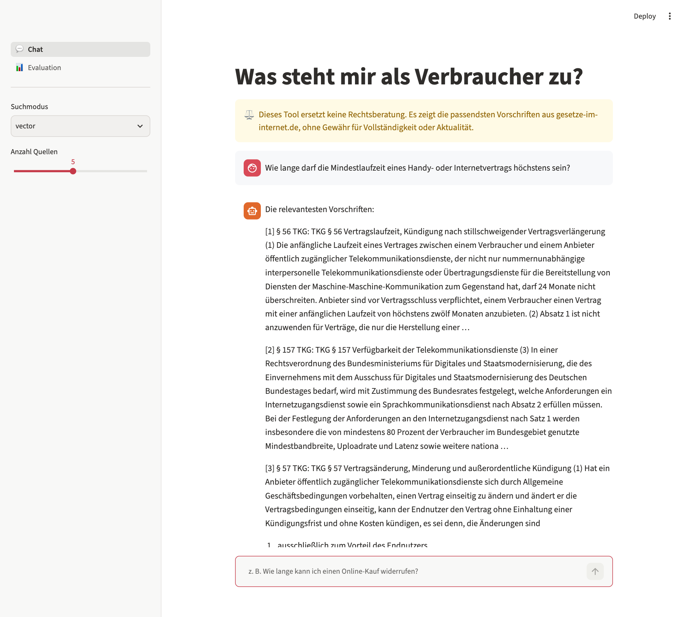
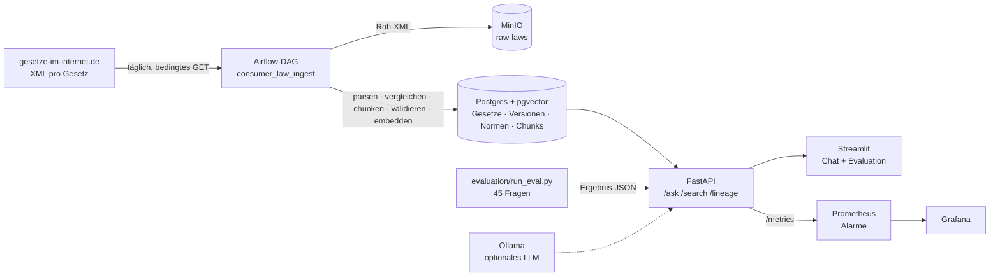

# Consumer Rights RAG

[](https://github.com/riodeb21195/proj4-consumer-rights-rag/actions/workflows/ci.yml)

**Was steht mir als Verbraucher in Deutschland rechtlich zu?** Eine Daten-Pipeline hält fünf
Bundesgesetze zum Verbraucherschutz aktuell und durchsuchbar und beantwortet Fragen mit genauer
Quelle: Gesetz und Paragraph.

> [!WARNING]
> **Keine Rechtsberatung.** Die Antworten sind gefundene Auszüge aus Gesetzestexten, unter
> Umständen unvollständig oder aus dem Zusammenhang gerissen. Im Ernstfall hilft eine
> Verbraucherzentrale oder ein Anwalt.





## Ergebnisse

45 deutsche Verbraucherfragen auf 1.022 Vorschriften (Verbraucherteile des BGB, EVO, PAngV, EnWG,
TKG), echter Lauf vom 18.11.2026. Alle Varianten: [docs/evaluation.md](docs/evaluation.md).

| Variante | Hit@1 | Hit@5 | Hit@10 | MRR |
|---|---:|---:|---:|---:|
| **Vektorsuche** (Standard) | 0,42 | **0,71** | 0,82 | 0,55 |
| Volltext (Postgres `german`) | 0,13 | 0,36 | 0,47 | 0,22 |
| Hybrid (RRF) | 0,38 | 0,62 | 0,76 | 0,49 |
| Hybrid + Cross-Encoder-Reranking (≈ 27 s/Frage auf CPU) | 0,51 | 0,82 | 0,87 | 0,65 |

Die Volltextsuche scheitert an Alltagsbegriffen („Kaution“ statt „Mietsicherheit“). Mischt man
sie dazu, sinkt die Qualität. Deshalb ist Vektorsuche der Standard; Hybrid-Suche und Reranking
bleiben wählbar.

## Quickstart

Docker mit ca. 5 GB RAM und ca. 15 GB freiem Speicher; keine GPU, keine API-Keys.

```bash
cp .env.example .env
make up        # Postgres, MinIO, Airflow, API, Streamlit, Prometheus, Grafana
make ingest    # erster Lauf ≈ 20 Min. auf einer Intel-CPU von 2019; danach nur Änderungen
open http://localhost:8501
```

## Tech-Stack

Python 3.12 (uv) · Airflow 3.4 · MinIO · Postgres 17 + pgvector · sentence-transformers
(`multilingual-e5-small`, CPU) · FastAPI · Streamlit · Prometheus · Grafana · GitHub Actions + GHCR

## Highlights

- **Inkrementeller Ingest:** Change Detection auf drei Ebenen (HTTP 304, XML-Hash, Hash pro
  Paragraph). Nur geänderte Paragraphen werden neu embedded, aufgehobene gelöscht.
- **Eine Transaktion pro Gesetz:** Bei einem kaputten Download wird zurückgerollt, und die
  vorherige Version bleibt durchsuchbar. Jeder Lauf wird in `ingest_runs` protokolliert.
- **Versionierter Index und Lineage:** Chunking-Strategie und Modell sind als Index-Konfiguration
  gespeichert. `/lineage/{answer_id}` verfolgt eine Antwort bis zum Roh-XML in MinIO zurück.
- **Evaluation als Quality Gate in der CI:** Der Build schlägt fehl, wenn Hit@5 auf dem
  Fixture-Set unter 0,70 fällt. Im laufenden Stack alarmiert Prometheus bei Verschlechterung.
- **Tests:** 112 Unit- und Integrationstests (testcontainers für Postgres und MinIO), 96 % Coverage.

## Was passiert, wenn…

- **ein Gesetz geändert wird:** Nur die geänderten Paragraphen bekommen neue Chunks, alle anderen
  behalten ihre IDs.
- **ein Paragraph aufgehoben wird:** Er verschwindet mit seinen Chunks aus dem Index.
- **das XML kaputt ist:** Das Gesetz wird übersprungen und gemeldet, die anderen laufen weiter.
- **der Ingest doppelt läuft:** Es wird nichts geschrieben, keine Duplikate.
- **die Retrieval-Qualität sinkt:** Die CI schlägt fehl, Prometheus löst `RagEvalBelowThreshold` aus.

Zu jedem Fall gibt es ein Demo-Skript (`make scenarios`). Weitere Fälle:
[docs/architecture.md](docs/architecture.md#what-happens-when).

## Design-Entscheidungen

- [ADR 0001](docs/decisions/0001-chunking-along-legal-structure.md): Chunking nach Paragraphen und Absätzen statt nach festen Fenstern
- [ADR 0002](docs/decisions/0002-embedding-model.md): `multilingual-e5-small`, kann Deutsch und ist schnell auf der CPU
- [ADR 0003](docs/decisions/0003-postgres-pgvector.md): Postgres + pgvector statt einer eigenen Vektordatenbank
- [ADR 0004](docs/decisions/0004-object-storage-minio.md): MinIO über das Chainguard-Image
- [ADR 0005](docs/decisions/0005-model-runtime-in-docker.md): Das Modell läuft in Linux-Containern
- [ADR 0006](docs/decisions/0006-retrieval-strategy.md): Vektorsuche als Standard, begründet durch die Evaluation

## Grenzen

- Keine Auslegung, keine Rechtsprechung, kein Landesrecht; das System findet nur Gesetzestext.
- Fünf Bundesgesetze, beim BGB nur die verbraucherrelevanten Teile.
- 45 Fragen von einem Autor; 13 davon werden nicht in den Top 5 beantwortet
  ([Liste](docs/evaluation.md#where-the-default-variant-fails)).
- Reranking bringt +0,11 Hit@5, ist auf der Ziel-CPU aber zu langsam.

## Dokumentation

[Architektur](docs/architecture.md) · [Evaluation](docs/evaluation.md) ·
[Runbook](docs/runbook.md) · [ADRs](docs/decisions/) · [Rebuild-Guide](docs/REBUILD_GUIDE.md)

Daten: [gesetze-im-internet.de](https://www.gesetze-im-internet.de); Bundesgesetze sind amtliche
Werke und urheberrechtsfrei (§ 5 UrhG).
