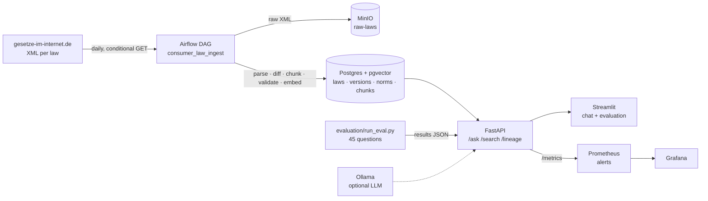

# Consumer Rights RAG

[](https://github.com/riodeb21195/proj4-consumer-rights-rag/actions/workflows/ci.yml)

**What am I entitled to as a consumer in Germany?** A data pipeline keeps five federal consumer
laws up to date and searchable, and answers questions with the exact law and paragraph.

> [!WARNING]
> **Not legal advice.** Answers are retrieved passages of statutory text, possibly incomplete or
> out of context. For a real case, ask a consumer advice centre (Verbraucherzentrale) or a lawyer.

[Screenshot der Streamlit-App einfügen]



## Results

45 German consumer questions over 1,022 provisions (BGB consumer parts, EVO, PAngV, EnWG, TKG),
real run on 2026-11-18. All variants: [docs/evaluation.md](docs/evaluation.md).

| Variant | Hit@1 | Hit@5 | Hit@10 | MRR |
|---|---:|---:|---:|---:|
| **vector search** (default) | 0.42 | **0.71** | 0.82 | 0.55 |
| full text (Postgres `german`) | 0.13 | 0.36 | 0.47 | 0.22 |
| hybrid (RRF) | 0.38 | 0.62 | 0.76 | 0.49 |
| hybrid + cross-encoder rerank (≈ 27 s/question on CPU) | 0.51 | 0.82 | 0.87 | 0.65 |

Full-text search fails on lay vocabulary ("Kaution" vs. "Mietsicherheit"), so fusing it in lowers
quality. Vector search is the default; hybrid and reranking stay selectable.

## Quickstart

Docker with ~5 GB RAM and ~15 GB free disk; no GPU, no API keys.

```bash
cp .env.example .env
make up        # Postgres, MinIO, Airflow, API, Streamlit, Prometheus, Grafana
make ingest    # first run ≈ 20 min on a 2019 Intel CPU; later runs only fetch changes
open http://localhost:8501
```

## Tech stack

Python 3.12 (uv) · Airflow 3.4 · MinIO · Postgres 17 + pgvector · sentence-transformers
(`multilingual-e5-small`, CPU) · FastAPI · Streamlit · Prometheus · Grafana · GitHub Actions + GHCR

## Highlights

- **Incremental ingest:** change detection on three levels (HTTP 304, XML hash, per-paragraph
  hash); only changed paragraphs are re-embedded, repealed ones are deleted.
- **One transaction per law:** a broken download rolls back and the previous version stays
  searchable. Every run is logged in `ingest_runs`.
- **Versioned index and lineage:** chunking strategy and model are stored as index configs;
  `/lineage/{answer_id}` traces an answer back to the raw XML in MinIO.
- **Evaluation as a CI quality gate:** the build fails if Hit@5 drops below 0.70 on the fixture
  set; Prometheus alerts on regressions in the running stack.
- **Tests:** 112 unit and integration tests (testcontainers for Postgres and MinIO), 96 % coverage.

## What happens when…

- **A law is amended:** only the changed paragraphs get new chunks; all other chunks keep their ids.
- **A paragraph is repealed:** it and its chunks disappear from the index.
- **The XML is broken:** the law is skipped and reported, the other laws continue.
- **The ingest runs twice:** nothing is written, no duplicates.
- **Retrieval quality drops:** CI fails, Prometheus raises `RagEvalBelowThreshold`.

Each case has a demo script (`make scenarios`). More cases: [docs/architecture.md](docs/architecture.md#what-happens-when).

## Design decisions

- [ADR 0001](docs/decisions/0001-chunking-along-legal-structure.md): chunking along paragraphs and Absätze, not fixed windows
- [ADR 0002](docs/decisions/0002-embedding-model.md): `multilingual-e5-small`, German-capable and fast on CPU
- [ADR 0003](docs/decisions/0003-postgres-pgvector.md): Postgres + pgvector instead of a separate vector database
- [ADR 0004](docs/decisions/0004-object-storage-minio.md): MinIO via the Chainguard image
- [ADR 0005](docs/decisions/0005-model-runtime-in-docker.md): the model runs in Linux containers
- [ADR 0006](docs/decisions/0006-retrieval-strategy.md): vector search by default, based on the evaluation

## Limitations

- No interpretation, case law or state law; the system only retrieves statutory text.
- Five federal laws, and only the consumer-relevant parts of the BGB.
- 45 questions from one author; 13 are not answered within the top 5 ([list](docs/evaluation.md#where-the-default-variant-fails)).
- Reranking adds +0.11 Hit@5 but is too slow on the target CPU.

## Documentation

[Architecture](docs/architecture.md) · [Evaluation](docs/evaluation.md) ·
[Runbook](docs/runbook.md) · [ADRs](docs/decisions/) · [Rebuild guide](docs/REBUILD_GUIDE.md)

Data: [gesetze-im-internet.de](https://www.gesetze-im-internet.de); German federal laws are
official works without copyright (§ 5 UrhG).
