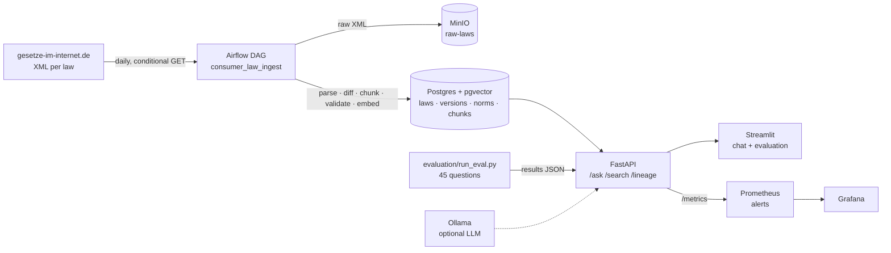

# Consumer Rights RAG

[](https://github.com/riodeb21195/proj4-consumer-rights-rag/actions/workflows/ci.yml)

**What am I entitled to as a consumer in Germany?** This project keeps the relevant federal
laws up to date and searchable, and answers questions with the exact law and paragraph.

> [!WARNING]
> **Not legal advice.** Answers are retrieved passages of statutory text, possibly incomplete or
> out of context. For a real case, ask a consumer advice centre (Verbraucherzentrale) or a lawyer.



**Retrieval quality** (45 German consumer questions, 1,022 provisions from BGB, EVO, PAngV, EnWG,
TKG; real run on 2026-11-18, details in [docs/evaluation.md](docs/evaluation.md)):

| Variant | Hit@1 | Hit@3 | Hit@5 | Hit@10 | MRR |
|---|---:|---:|---:|---:|---:|
| **vector, paragraph chunks** (default) | 0.42 | 0.64 | **0.71** | 0.82 | 0.55 |
| vector, Absatz chunks | 0.42 | 0.60 | 0.71 | 0.84 | 0.55 |
| full text (Postgres `german`) | 0.13 | 0.20 | 0.36 | 0.47 | 0.22 |
| hybrid (RRF), paragraph chunks | 0.38 | 0.53 | 0.62 | 0.76 | 0.49 |
| hybrid (RRF), Absatz chunks | 0.38 | 0.53 | 0.62 | 0.78 | 0.49 |
| hybrid + cross-encoder rerank (≈ 27 s/question) | 0.51 | 0.78 | 0.82 | 0.87 | 0.65 |

**Quickstart** (Docker with ~5 GB RAM and ~15 GB free disk; no GPU, no API keys):

```bash
cp .env.example .env
make up        # Postgres, MinIO, Airflow, API, Streamlit, Prometheus, Grafana
make ingest    # first run ≈ 20 min on a 2019 Intel CPU; later runs only fetch changes
open http://localhost:8501
```

---

## Contents

- [How it works](#how-it-works)
- [What happens when…](#what-happens-when)
- [Design decisions](#design-decisions)
- [Limitations](#limitations)
- [Development](#development)

## How it works

### Data source

[gesetze-im-internet.de](https://www.gesetze-im-internet.de) publishes every federal law as a ZIP
with one XML file (`gii-norm.dtd`), e.g. `https://www.gesetze-im-internet.de/bgb/xml.zip`. Laws are
official works and free of copyright (§ 5 UrhG). The selection is configured in
`src/rag/config.py`:

| Law | Slug | Scope |
|---|---|---|
| Bürgerliches Gesetzbuch | `bgb` | §§ 13–14, 241–361, 433–480, 488–515, 535–580a, 631–651y (contracts, consumer contracts, sale, consumer credit, tenancy, work and travel contracts) |
| Eisenbahn-Verkehrsordnung | `evo_2023` | complete |
| Preisangabenverordnung | `pangv_2022` | complete |
| Energiewirtschaftsgesetz | `enwg_2005` | complete |
| Telekommunikationsgesetz | `tkg_2021` | complete |

Before ingesting, the DAG checks every slug against the official index `gii-toc.xml`, because
laws get re-published under new slugs (the EVO is `evo_2023`, not `evo`).

### Ingest (`src/rag/ingest/`, `airflow/dags/consumer_law_ingest.py`)

The DAG runs daily, one task per law. Change detection works on three levels, so an unchanged day
costs one HTTP request per law:

1. **HTTP:** `If-None-Match` / `If-Modified-Since` → `304 Not Modified` ends the task.
2. **File:** SHA-256 of the XML. A new file is archived in MinIO
   (`raw-laws/<slug>/<builddate>_<sha>.xml`) and recorded as a new row in `law_versions`.
3. **Provision:** a content hash per norm (title + text). Only added or changed norms are
   re-chunked and re-embedded; norms that disappeared or are marked `(weggefallen)` are deleted
   together with their chunks.

Each law is processed in one database transaction: a failure leaves the previous version
untouched. Every run is logged in `ingest_runs` with per-law statistics and errors.

### Processing (`src/rag/process/`)

- **Chunking** follows the legal structure: one chunk per paragraph (`paragraph`, default;
  long paragraphs are cut at Absatz boundaries into pieces of at most 2,000 characters), or one
  per Absatz (`absatz`). An Absatz that alone exceeds the limit is split at list items, then at
  sentence ends. The embedded text is prefixed with law, paragraph, Absatz, heading and the
  enclosing section title.
- **Metadata per chunk:** law, paragraph, Absatz, heading, Stand, source URL (deep link to the
  paragraph), law version; the norm keeps its structural path (Buch/Abschnitt/Titel).
- **Validation:** empty and duplicate chunks are dropped, too long chunks are reported.
- **Embedding:** `intfloat/multilingual-e5-small` (384 dimensions) on CPU.
- **Index versioning:** chunking strategy + chunking version + embedding model form an
  `index_configs` row. Changing any of them builds a new index next to the old one; the API
  switches only after the new index is complete.

### Retrieval and answers (`src/rag/retrieval/`, `src/rag/api/`)

- `vector` (default): cosine search on an HNSW index. `fulltext`: Postgres `german` text search.
  `hybrid`: Reciprocal Rank Fusion of both. Optional cross-encoder reranking.
- Without an LLM, `/ask` returns the most relevant paragraphs with citations
  ("§ 312g BGB") and links. With the optional Ollama profile, a small local model writes an answer
  based only on those paragraphs; citations are always attached.
- **Lineage:** every answer is stored in `answer_log`. `GET /lineage/{answer_id}` returns the
  chunks, law versions, Stand and the MinIO key of the raw XML behind the answer.

### Evaluation, monitoring, CI/CD

- `make eval` runs all retrieval variants over `evaluation/questions.jsonl` and stores results as
  versioned JSON (git SHA, index config, rank per question) in `evaluation/results/`.
- The API exposes request count, latency and errors plus the latest evaluation results as
  Prometheus metrics. Grafana shows them on the provisioned dashboard "Consumer Rights RAG".
  Alerts: evaluation below threshold, regression vs. the previous run, API down, error rate,
  latency (`monitoring/alerts.yml`).
- **CI** (every push and pull request): ruff + mypy, unit and integration tests
  (testcontainers, coverage gate 80 %), and an **evaluation quality gate**: the committed fixture
  set (trimmed BGB, EVO, PAngV) is indexed with the real model, and the build fails if Hit@5 of
  the default variant drops below 0.70.
- **CD** (main, after green CI): API and Streamlit images to GitHub Container Registry.
  Dependabot keeps Python packages, actions and base images current.

## What happens when…

| …this happens | …the pipeline does this | Demo |
|---|---|---|
| a law is amended | Only the changed paragraphs get new chunks and embeddings; all other chunks keep their ids. | `scripts/scenario_law_changed.py` |
| a paragraph is repealed | It is removed from `norms` and its chunks disappear from the index. | `scripts/scenario_paragraph_repealed.py` |
| the downloaded XML is broken | The law's transaction is rolled back, the old version stays searchable, the error is stored in `ingest_runs` and the other laws continue. | `scripts/scenario_broken_xml.py` |
| the ingest runs twice | The second run finds the same hashes and writes nothing; no duplicates. | `scripts/scenario_duplicate_ingest.py` |
| the source is down | 3 retries per download, 1 Airflow retry; the index keeps serving the last version. | – |
| a law gets a new slug | `check_sources` fails before anything is ingested. | – |
| the chunking strategy or model changes | A new index is built next to the old one and activated when complete. | `docs/runbook.md` |
| retrieval quality drops | CI fails the build; in the running stack Prometheus raises `RagEvalBelowThreshold` / `RagEvalRegression`. | `docs/evaluation.md` |

Run all four demos against the running stack with `make scenarios`. Operations: see
[docs/runbook.md](docs/runbook.md).

## Design decisions

Architecture Decision Records in [docs/decisions/](docs/decisions/):

- [0001](docs/decisions/0001-chunking-along-legal-structure.md) Chunking along the legal
  structure (paragraph default, Absatz as variant)
- [0002](docs/decisions/0002-embedding-model.md) `multilingual-e5-small`: German-capable, 384
  dimensions, fast enough on an old CPU
- [0003](docs/decisions/0003-postgres-pgvector.md) Postgres + pgvector: vectors, full text,
  metadata and lineage in one transactional store
- [0004](docs/decisions/0004-object-storage-minio.md) MinIO for the raw XML, via the Chainguard
  image after the official image was discontinued
- [0005](docs/decisions/0005-model-runtime-in-docker.md) The model runs in Linux containers
  (no current PyTorch wheels for Intel Macs); local tests use a deterministic fake embedder
- [0006](docs/decisions/0006-retrieval-strategy.md) Vector search by default: hybrid search is
  implemented and evaluated but lowers quality on lay questions; reranking is the best variant
  but too slow on CPU

## Limitations

- **Not legal advice.** The system retrieves statutory text; it does not interpret it, knows no
  case law and no state law, and does not check whether a provision applies to a specific case.
- Only five federal laws, and only selected parts of the BGB.
- 45 evaluation questions from one author; one question moves Hit@k by 2.2 points. 13 of 45
  questions are not answered within the top 5 (listed in `docs/evaluation.md`).
- Lay vocabulary ("Kaution", "Handyvertrag") vs. legal terms ("Mietsicherheit") limits full-text
  and therefore hybrid search; there is no synonym dictionary.
- The reranker would add +0.11 Hit@5 but needs ≈ 27 s per question on the target hardware.
- One EnWG provision yields only empty chunks (dropped by validation); because it has no chunk,
  it is re-checked on every run.
- Single-node setup with default credentials, meant for local use.

## Development

```bash
uv sync                 # Python 3.12; the ml extra (torch) installs only on Linux
make lint               # ruff, ruff format --check, mypy (strict)
make test               # pytest with unit + integration tests (Docker needed), coverage
make eval               # evaluation inside the api container
make scenarios          # failure-scenario demos
make help               # all targets
```

Layout: `src/rag/` (ingest, process, store, retrieval, api), `airflow/dags/`, `db/init/`
(schema), `evaluation/`, `app/` (Streamlit), `monitoring/`, `scripts/`, `tests/`.
